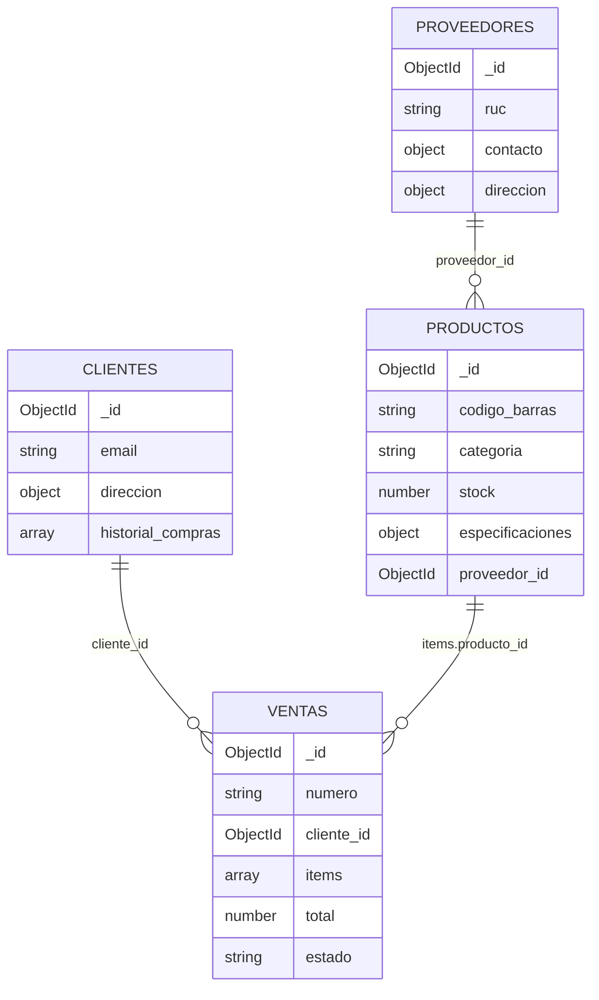

# 💻 Sistema para Venta de Computadoras — MongoDB + API REST

Base de datos orientada a documentos en **MongoDB** para una tienda de computadoras, con una API REST en **Node.js + Express + Mongoose** que gestiona productos, clientes, proveedores y ventas, más reportes construidos con **Aggregation Pipeline**.

## 👤 Datos de identificación

| | |
|---|---|
| **Estudiante** | Marcelo Giovanni Castañeda Cano |
| **Carrera** | _[Ingeniería de Sistemas e Informática]_ |
| **Asignatura** | Ingeniería Web |
| **Universidad** | Universidad Continental |
| **Actividad** | Semana 12 — Base de datos MongoDB y rutas API |

## 📝 Descripción técnica

| Tecnología | Versión |
|---|---|
| MongoDB Server | 7.0 o superior (recomendado 8.0) — local o MongoDB Atlas |
| mongosh | 2.x |
| Node.js | 18 o superior |
| Mongoose | 8.x |
| Express | 5.x |
| Otros | dotenv, cors, helmet, morgan |

**Base de datos:** `venta_computadoras`. Tiene **4 colecciones**:

| Colección | Documentos de prueba | Embebe | Referencia |
|---|---|---|---|
| `proveedores` | 4 | `contacto`, `direccion`, `marcas[]` | — |
| `productos` | 12 | `especificaciones` (según la categoría), `etiquetas[]` | `proveedor_id` → proveedores |
| `clientes` | 6 | `direccion`, `historial_compras[]` (últimas 10) | `historial_compras.venta_id` → ventas |
| `ventas` | 10 | `items[]` (detalle), `cliente{}` (copia fiscal) | `cliente_id` → clientes, `items.producto_id` → productos |

Características:

- **Validación en dos niveles**: validadores `$jsonSchema` en el servidor MongoDB y esquemas Mongoose en la API.
- **14 índices**: únicos (código de barras, SKU, correo, documento, RUC, número de comprobante), compuestos, multikey y de texto en español.
- **Ventas sin sobreventa**: el stock se descuenta con `findOneAndUpdate({ stock: { $gte: cantidad } }, { $inc })`, una operación atómica.
- **5 reportes** con `$match`, `$group`, `$unwind`, `$lookup`, `$project`, `$sort` y `$limit`.

## 📁 Estructura del repositorio

```
.
├── README.md
├── package.json
├── .env.example                  # Plantilla de variables de entorno (el .env real no se sube)
├── index.js                      # Servidor Express
├── seed.js                       # Carga los datos de prueba con Mongoose (npm run seed)
├── docs/
│   ├── modelo-documentos.md      # Diagrama, documentos de ejemplo e índices
│   └── justificacion-modelado.md # Por qué embeber o referenciar en cada caso
├── models/                       # Esquemas Mongoose
│   ├── Producto.js
│   ├── Cliente.js
│   ├── Proveedor.js
│   └── Venta.js
├── routes/
│   ├── endpoints.md              # Documentación de todas las rutas + ejemplos JSON
│   ├── productoRoutes.js
│   ├── clienteRoutes.js
│   ├── proveedorRoutes.js
│   ├── ventaRoutes.js
│   └── reporteRoutes.js          # Endpoints con Aggregation Pipeline
└── database/
    ├── 01_crear_colecciones.js   # createCollection + validadores $jsonSchema
    ├── 02_indices.js             # createIndex
    ├── 03_insertar_datos.js      # insertMany desde los .json
    ├── 04_consultas.js           # find / update / delete con operadores
    ├── 05_agregaciones.js        # Reportes con aggregate()
    └── json/                     # Datos para mongoimport (Extended JSON)
        ├── proveedores.json
        ├── productos.json
        ├── clientes.json
        └── ventas.json
```

## 🗺️ Modelo de documentos



- Diagrama completo, documentos de ejemplo e índices: **[docs/modelo-documentos.md](docs/modelo-documentos.md)**
- Justificación de embeber o referenciar: **[docs/justificacion-modelado.md](docs/justificacion-modelado.md)**

## 🚀 Instalación y ejecución

### 1. Clonar e instalar dependencias

```bash
git clone https://github.com/Marcelo-CC/-Sistema-para-Venta-de-Computadoras-MongoDB-.git
cd ./-Sistema-para-Venta-de-Computadoras-MongoDB-
npm install
```

### 2. Configurar la conexión

Copiar la plantilla y editarla:

```bash
cp .env.example .env        # en PowerShell: Copy-Item .env.example .env
```

**MongoDB local** (con el servicio `mongod` iniciado):

```env
MONGO_URI=mongodb://localhost:27017/venta_computadoras
PORT=3000
```

**MongoDB Atlas**:

1. Crear un clúster gratuito (M0) en [cloud.mongodb.com](https://cloud.mongodb.com).
2. En **Database Access**, crear un usuario de base de datos. En **Network Access**, agregar tu IP.
3. En **Connect → Drivers**, copiar la cadena de conexión y agregar el nombre de la base de datos:

```env
MONGO_URI=mongodb+srv://<usuario>:<password>@<cluster>.mongodb.net/venta_computadoras?retryWrites=true&w=majority
```

> 🔒 El archivo `.env` está en `.gitignore`. **Nunca** subas usuarios ni contraseñas al repositorio.

### 3. Crear la base de datos y cargar los datos

**Opción A — Scripts mongosh** (recomendada: crea validadores e índices). Ejecutar desde la raíz del repositorio:

```bash
mongosh "mongodb://localhost:27017" database/01_crear_colecciones.js
mongosh "mongodb://localhost:27017" database/02_indices.js
mongosh "mongodb://localhost:27017" database/03_insertar_datos.js
```

Con Atlas, reemplazar la URL por `"mongodb+srv://<usuario>:<password>@<cluster>.mongodb.net/"`. También se puede usar `load("database/01_crear_colecciones.js")` dentro de una sesión de mongosh.

**Opción B — Seeder con Mongoose** (usa la conexión del `.env`):

```bash
npm run seed
```

**Opción C — mongoimport** (MongoDB Database Tools):

```bash
mongoimport --uri "mongodb://localhost:27017/venta_computadoras" --collection proveedores --file database/json/proveedores.json --jsonArray --drop
mongoimport --uri "mongodb://localhost:27017/venta_computadoras" --collection productos   --file database/json/productos.json   --jsonArray --drop
mongoimport --uri "mongodb://localhost:27017/venta_computadoras" --collection clientes    --file database/json/clientes.json    --jsonArray --drop
mongoimport --uri "mongodb://localhost:27017/venta_computadoras" --collection ventas      --file database/json/ventas.json      --jsonArray --drop
```

Las opciones B y C también crean las colecciones, pero **sin validadores**. Para tenerlos, ejecuta antes `01_crear_colecciones.js`.

### 4. Probar consultas y agregaciones en mongosh

```bash
mongosh "mongodb://localhost:27017" database/04_consultas.js
mongosh "mongodb://localhost:27017" database/05_agregaciones.js
```

### 5. Levantar la API

```bash
npm start          # o: npm run dev (se reinicia al guardar cambios)
```

```
MongoDB conectado
Servidor corriendo en http://localhost:3000/api
```

## 🔌 Rutas principales

| Método | Ruta | Descripción |
|---|---|---|
| GET | `/api/productos` | Catálogo (filtros `?categoria=&marca=&min=&max=&q=`) |
| GET | `/api/productos/categoria/:tipo` | Productos por categoría (`laptop`, `monitor`, …) |
| GET | `/api/productos/codigo-barras/:codigo` | Búsqueda por código de barras |
| GET | `/api/productos/:id` | Producto + proveedor (`populate`) |
| POST / PATCH / DELETE | `/api/productos[/:id]` | Crear, actualizar y dar de baja |
| PATCH | `/api/productos/:id/stock` | Reponer o descontar stock |
| GET / POST / PATCH / DELETE | `/api/clientes[/:id]` | CRUD de clientes |
| GET | `/api/clientes/:id/ventas` | Historial completo de compras |
| GET / POST / PATCH / DELETE | `/api/proveedores[/:id]` | CRUD de proveedores |
| GET | `/api/ventas` | Ventas (filtros `?estado=&desde=&hasta=`) |
| POST | `/api/ventas` | Registrar venta (descuenta stock, calcula IGV) |
| PATCH | `/api/ventas/:id/pagar` · `/anular` | Cambiar estado; anular devuelve stock |
| GET | `/api/reportes/ventas-por-mes?anio=2026` | Aggregation: `$match → $group → $project` |
| GET | `/api/reportes/productos-mas-vendidos` | Aggregation: `$unwind → $group → $lookup` |
| GET | `/api/reportes/stock-critico` | Aggregation: `$match($expr) → $lookup` |
| GET | `/api/reportes/ventas-por-categoria` | Aggregation: `$unwind → $group` |
| GET | `/api/reportes/mejores-clientes` | Aggregation: `$group → $lookup` |

Las 32 rutas, los cuerpos JSON de ejemplo para Postman, los códigos de error y el diagrama de secuencia de una venta están en **[routes/endpoints.md](routes/endpoints.md)**.

### Prueba rápida con Postman o el navegador

```
GET  http://localhost:3000/api/productos/categoria/laptop
GET  http://localhost:3000/api/productos?q=gaming
GET  http://localhost:3000/api/clientes/66c000000000000000000001/ventas
GET  http://localhost:3000/api/reportes/productos-mas-vendidos
GET  http://localhost:3000/api/reportes/stock-critico
```

Los datos de prueba usan `_id` fijos para que estas URLs funcionen tal cual: proveedores `66a…01`–`66a…04`, productos `66b…01`–`66b…12`, clientes `66c…01`–`66c…06`, ventas `66d…01`–`66d…10`.

## 📊 Ejemplo de Aggregation Pipeline — productos más vendidos

```js
db.ventas.aggregate([
  { $match: { estado: { $ne: 'ANULADA' } } },             // solo ventas válidas
  { $unwind: '$items' },                                   // un documento por ítem vendido
  { $group: {                                              // sumar por producto
      _id: '$items.producto_id',
      unidades_vendidas: { $sum: '$items.cantidad' },
      ingresos: { $sum: '$items.subtotal' } } },
  { $sort: { unidades_vendidas: -1 } },
  { $limit: 5 },
  { $lookup: { from: 'productos', localField: '_id',       // traer stock y marca actuales
               foreignField: '_id', as: 'producto' } },
  { $unwind: '$producto' },
  { $project: { _id: 0, nombre: '$producto.nombre', unidades_vendidas: 1,
                ingresos: 1, stock_actual: '$producto.stock' } }
])
```

Más reportes (ventas por mes, stock crítico, margen bruto, mejores clientes, ventas por vendedor) en [`database/05_agregaciones.js`](database/05_agregaciones.js).
