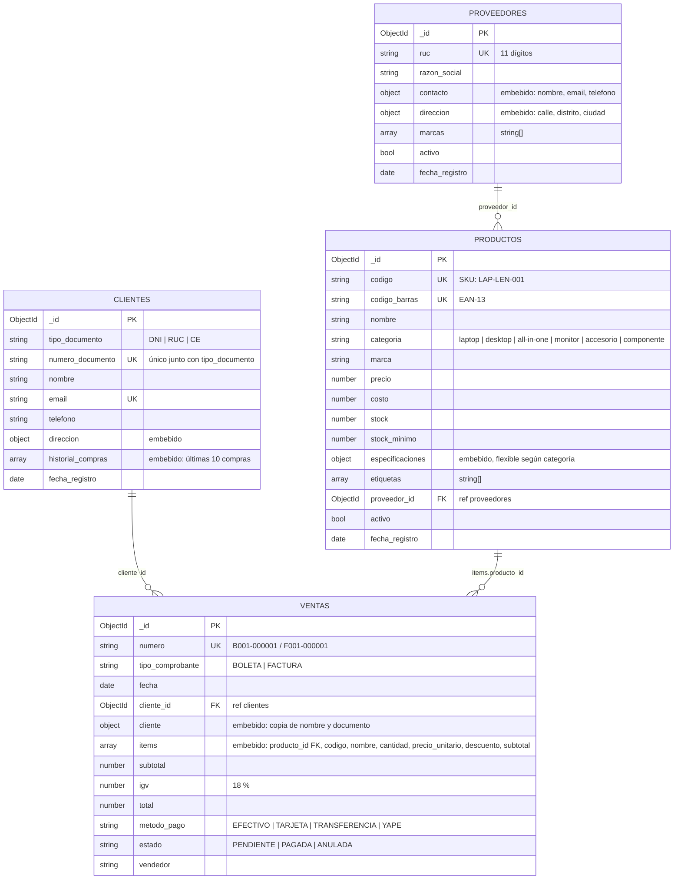

# Modelo de documentos — `venta_computadoras`

Base de datos MongoDB con 4 colecciones. Las líneas continuas son **referencias por `ObjectId`**; los bloques internos de cada colección son **subdocumentos o arreglos embebidos**.

## Diagrama



Vista de la estructura (qué está embebido dentro de qué):

```
proveedores ─────────────┐                 clientes ───────────────────┐
  contacto {…}           │                   direccion {…}             │
  direccion {…}          │                   historial_compras [ … ] ◄─┼─ resumen de ventas
  marcas [ … ]           │                                             │
                         │ proveedor_id                                │ cliente_id
                         ▼                                             ▼
productos ◄───────────── items[].producto_id ─────────────────────── ventas
  especificaciones {…}                                                 cliente {…}   (copia)
  etiquetas [ … ]                                                      items [ … ]   (embebido)
```

## Documentos de ejemplo

### `productos` — las especificaciones cambian según la categoría

```json
{
  "_id": { "$oid": "66b000000000000000000002" },
  "codigo": "LAP-ASU-002",
  "codigo_barras": "7750000000028",
  "nombre": "ASUS TUF Gaming F15",
  "categoria": "laptop",
  "marca": "ASUS",
  "precio": 4899,
  "costo": 3950,
  "stock": 3,
  "stock_minimo": 3,
  "proveedor_id": { "$oid": "66a000000000000000000002" },
  "etiquetas": ["gaming", "alto rendimiento"],
  "especificaciones": {
    "procesador": "Intel Core i7-12700H",
    "ram_gb": 16,
    "almacenamiento": { "tipo": "SSD NVMe", "capacidad_gb": 1024 },
    "gpu": "NVIDIA GeForce RTX 4060 8GB",
    "pantalla_pulgadas": 15.6,
    "frecuencia_hz": 144,
    "sistema_operativo": "Windows 11 Home",
    "peso_kg": 2.2
  },
  "activo": true
}
```

Un monitor de la misma colección tiene otras especificaciones:

```json
"especificaciones": {
  "pantalla_pulgadas": 27,
  "resolucion": "2560x1440",
  "panel": "VA",
  "frecuencia_hz": 165,
  "curvo": true,
  "puertos": ["HDMI", "DisplayPort"]
}
```

### `ventas` — cabecera e ítems en un solo documento

```json
{
  "_id": { "$oid": "66d000000000000000000001" },
  "numero": "B001-000001",
  "tipo_comprobante": "BOLETA",
  "fecha": { "$date": "2026-03-14T16:20:00Z" },
  "cliente_id": { "$oid": "66c000000000000000000001" },
  "cliente": { "nombre": "Carlos Pérez Rojas", "tipo_documento": "DNI", "numero_documento": "45678912" },
  "items": [
    { "producto_id": { "$oid": "66b000000000000000000001" }, "codigo": "LAP-LEN-001", "nombre": "Lenovo IdeaPad Slim 5 14\"",
      "categoria": "laptop", "cantidad": 1, "precio_unitario": 3299, "descuento": 0, "subtotal": 3299 },
    { "producto_id": { "$oid": "66b000000000000000000010" }, "codigo": "ACC-LOG-010", "nombre": "Logitech MX Master 3S",
      "categoria": "accesorio", "cantidad": 1, "precio_unitario": 449, "descuento": 20, "subtotal": 429 }
  ],
  "subtotal": 3728,
  "igv": 671.04,
  "total": 4399.04,
  "metodo_pago": "TARJETA",
  "estado": "PAGADA",
  "vendedor": "Ana Martínez"
}
```

### `clientes` — con el historial de compras embebido

```json
{
  "_id": { "$oid": "66c000000000000000000001" },
  "tipo_documento": "DNI",
  "numero_documento": "45678912",
  "nombre": "Carlos Pérez Rojas",
  "email": "carlos.perez@gmail.com",
  "telefono": "987654321",
  "direccion": { "calle": "Jr. Puno 345", "distrito": "Huancayo", "ciudad": "Huancayo" },
  "historial_compras": [
    { "venta_id": { "$oid": "66d000000000000000000001" }, "numero": "B001-000001", "fecha": { "$date": "2026-03-14T16:20:00Z" }, "total": 4399.04, "estado": "PAGADA" },
    { "venta_id": { "$oid": "66d000000000000000000006" }, "numero": "B001-000004", "fecha": { "$date": "2026-07-22T17:00:00Z" }, "total": 341.02, "estado": "ANULADA" }
  ]
}
```

## Dónde está definido cada esquema

| Colección | Validador JSON Schema (servidor) | Modelo Mongoose (API) | Datos de prueba |
|---|---|---|---|
| `proveedores` | [`database/01_crear_colecciones.js`](../database/01_crear_colecciones.js) | [`models/Proveedor.js`](../models/Proveedor.js) | [`database/json/proveedores.json`](../database/json/proveedores.json) (4) |
| `productos` | ″ | [`models/Producto.js`](../models/Producto.js) | [`database/json/productos.json`](../database/json/productos.json) (12) |
| `clientes` | ″ | [`models/Cliente.js`](../models/Cliente.js) | [`database/json/clientes.json`](../database/json/clientes.json) (6) |
| `ventas` | ″ | [`models/Venta.js`](../models/Venta.js) | [`database/json/ventas.json`](../database/json/ventas.json) (10) |

Hay validación en dos niveles. **Mongoose** valida en la API y devuelve mensajes claros (HTTP 400). El **`$jsonSchema`** de MongoDB valida en el servidor, así que incluso un `insertOne` hecho a mano en `mongosh` es rechazado si, por ejemplo, el stock es negativo.

## Índices

| Colección | Índice | Tipo | Para qué sirve |
|---|---|---|---|
| productos | `{ codigo: 1 }` | único | SKU interno |
| productos | `{ codigo_barras: 1 }` | único | `GET /api/productos/codigo-barras/:codigo` (lector en caja) |
| productos | `{ categoria: 1, precio: 1 }` | compuesto | `GET /api/productos/categoria/:tipo` ordenado por precio |
| productos | `{ marca: 1 }` | simple | filtro `?marca=` |
| productos | `{ proveedor_id: 1 }` | simple | `GET /api/proveedores/:id/productos` y `$lookup` |
| productos | `{ nombre, marca, etiquetas: "text" }` | texto (español) | `GET /api/productos?q=gaming` |
| clientes | `{ email: 1 }` | único | búsqueda por correo |
| clientes | `{ tipo_documento: 1, numero_documento: 1 }` | único compuesto | `GET /api/clientes/documento/:tipo/:numero` |
| proveedores | `{ ruc: 1 }` | único | no repetir RUC |
| ventas | `{ numero: 1 }` | único | correlativo de comprobante |
| ventas | `{ fecha: -1 }` | simple | reportes por fecha |
| ventas | `{ cliente_id: 1, fecha: -1 }` | compuesto | historial de un cliente |
| ventas | `{ estado: 1, fecha: -1 }` | compuesto | ventas pendientes o anuladas |
| ventas | `{ "items.producto_id": 1 }` | multikey | ventas que contienen un producto |
