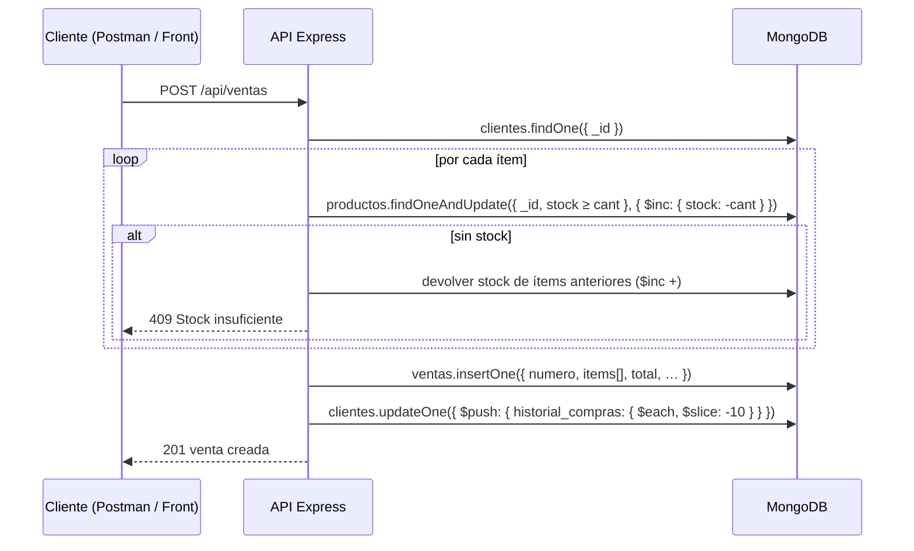

# Rutas / Endpoints de la API

Base URL: `http://localhost:3000/api` · Formato: JSON

Cada ruta indica la operación de Mongoose o MongoDB que la resuelve. El código está en los archivos `*Routes.js` de esta carpeta.

## Resumen

| Método | Ruta | Descripción | Operación MongoDB |
|---|---|---|---|
| GET | `/api` | Estado de la API y de la conexión | — |
| **Productos** — [`productoRoutes.js`](productoRoutes.js) ||||
| GET | `/api/productos` | Catálogo. Filtros: `?categoria=` `?marca=` `?min=` `?max=` `?q=` | `find({ activo: true, precio: { $gte, $lte }, $text })` |
| GET | `/api/productos/categoria/:tipo` | Productos de una categoría ordenados por precio | `find({ categoria })` — índice `{ categoria, precio }` |
| GET | `/api/productos/codigo-barras/:codigo` | Buscar por código de barras | `findOne({ codigo_barras })` — índice único |
| GET | `/api/productos/:id` | Producto con datos del proveedor | `findById().populate('proveedor_id')` |
| POST | `/api/productos` | Crear producto | `create()` |
| PATCH | `/api/productos/:id` | Actualizar campos | `findByIdAndUpdate(…, { runValidators })` |
| PATCH | `/api/productos/:id/stock` | Reponer (`+`) o descontar (`-`) stock | `findOneAndUpdate({ stock: { $gte } }, { $inc })` |
| DELETE | `/api/productos/:id` | Baja lógica | `findByIdAndUpdate({ activo: false })` |
| **Clientes** — [`clienteRoutes.js`](clienteRoutes.js) ||||
| GET | `/api/clientes` | Listar clientes | `find()` |
| GET | `/api/clientes/documento/:tipo/:numero` | Buscar por DNI o RUC | `findOne({ tipo_documento, numero_documento })` |
| GET | `/api/clientes/:id` | Cliente con resumen de sus últimas compras | `findById()` |
| GET | `/api/clientes/:id/ventas` | Historial completo de compras | `Venta.find({ cliente_id })` |
| POST | `/api/clientes` | Crear cliente | `create()` |
| PATCH | `/api/clientes/:id` | Actualizar cliente | `findByIdAndUpdate()` |
| DELETE | `/api/clientes/:id` | Eliminar (solo si no tiene ventas) | `exists()` + `findByIdAndDelete()` |
| **Proveedores** — [`proveedorRoutes.js`](proveedorRoutes.js) ||||
| GET | `/api/proveedores` | Listar proveedores | `find()` |
| GET | `/api/proveedores/:id` | Obtener proveedor | `findById()` |
| GET | `/api/proveedores/:id/productos` | Productos que abastece | `Producto.find({ proveedor_id })` |
| POST | `/api/proveedores` | Crear proveedor | `create()` |
| PATCH | `/api/proveedores/:id` | Actualizar proveedor | `findByIdAndUpdate()` |
| DELETE | `/api/proveedores/:id` | Eliminar (solo si no tiene productos) | `exists()` + `findByIdAndDelete()` |
| **Ventas** — [`ventaRoutes.js`](ventaRoutes.js) ||||
| GET | `/api/ventas` | Listar ventas. Filtros: `?estado=` `?desde=` `?hasta=` `?cliente=` | `find({ estado, fecha: { $gte, $lte } })` |
| GET | `/api/ventas/:id` | Venta con cliente y productos actuales | `findById().populate('cliente_id').populate('items.producto_id')` |
| POST | `/api/ventas` | Registrar venta (descuenta stock) | `findOneAndUpdate($inc)` por ítem + `create()` + `$push/$slice` |
| PATCH | `/api/ventas/:id/pagar` | `PENDIENTE` → `PAGADA` | `findOneAndUpdate({ estado: 'PENDIENTE' })` |
| PATCH | `/api/ventas/:id/anular` | Anular y devolver el stock | `findOneAndUpdate()` + `bulkWrite($inc)` |
| **Reportes (Aggregation Pipeline)** — [`reporteRoutes.js`](reporteRoutes.js) ||||
| GET | `/api/reportes/ventas-por-mes?anio=2026` | Cantidad, total y ticket promedio por mes | `$match → $addFields → $group → $sort → $project` |
| GET | `/api/reportes/productos-mas-vendidos?limite=5` | Ranking de productos | `$match → $unwind → $group → $sort → $limit → $lookup → $project` |
| GET | `/api/reportes/stock-critico` | Productos con `stock <= stock_minimo` y su proveedor | `$match($expr) → $lookup → $unwind → $project` |
| GET | `/api/reportes/ventas-por-categoria` | Unidades e ingresos por categoría | `$match → $unwind → $group → $project` |
| GET | `/api/reportes/mejores-clientes?limite=5` | Clientes que más compran | `$match → $group → $sort → $lookup → $project` |

Las ventas no se eliminan: se **anulan**, para conservar la numeración de comprobantes.

## Códigos de respuesta

| Código | Cuándo |
|---|---|
| `200` | Consulta o actualización correcta |
| `201` | Documento creado |
| `400` | `ObjectId` mal formado, error de validación del esquema o JSON inválido |
| `404` | El documento no existe |
| `409` | Duplicado (índice único), stock insuficiente, estado de venta inválido o eliminación bloqueada |
| `500` | Error interno |

## Ejemplos de cuerpos JSON (Postman)

Seleccionar **Body → raw → JSON**.

### `POST /api/productos`

```json
{
  "codigo": "LAP-ACE-013",
  "codigo_barras": "7750000000134",
  "nombre": "Acer Aspire 5 15\"",
  "categoria": "laptop",
  "marca": "Acer",
  "precio": 2599,
  "costo": 2050,
  "stock": 7,
  "stock_minimo": 3,
  "proveedor_id": "66a000000000000000000002",
  "etiquetas": ["estudiantes", "oficina"],
  "especificaciones": {
    "procesador": "Intel Core i5-1235U",
    "ram_gb": 8,
    "almacenamiento": { "tipo": "SSD", "capacidad_gb": 512 },
    "pantalla_pulgadas": 15.6,
    "sistema_operativo": "Windows 11 Home"
  }
}
```

### `PATCH /api/productos/66b000000000000000000004/stock`

```json
{ "cantidad": 10 }
```

### `POST /api/clientes`

```json
{
  "tipo_documento": "DNI",
  "numero_documento": "72345678",
  "nombre": "Sofía Ramos Cárdenas",
  "email": "sofia.ramos@gmail.com",
  "telefono": "945112233",
  "direccion": { "calle": "Av. Giráldez 560", "distrito": "Huancayo", "ciudad": "Huancayo" }
}
```

### `POST /api/proveedores`

```json
{
  "ruc": "20654321987",
  "razon_social": "Distribuidora Sierra Tech S.A.C.",
  "contacto": { "nombre": "Mario Paredes", "email": "ventas@sierratech.pe", "telefono": "064556677" },
  "direccion": { "calle": "Jr. Ancash 300", "distrito": "Huancayo", "ciudad": "Huancayo" },
  "marcas": ["MSI", "Gigabyte"]
}
```

### `POST /api/ventas`

```json
{
  "cliente_id": "66c000000000000000000002",
  "tipo_comprobante": "BOLETA",
  "metodo_pago": "TARJETA",
  "vendedor": "Ana Martínez",
  "items": [
    { "producto_id": "66b000000000000000000003", "cantidad": 1 },
    { "producto_id": "66b000000000000000000010", "cantidad": 1, "descuento": 20 }
  ]
}
```

La API completa cada ítem con el nombre y el precio actual, calcula `subtotal`, `igv` (18 %) y `total`, y asigna el siguiente número (`B001-000008`). Además descuenta el stock y agrega la compra al `historial_compras` del cliente.

Respuestas de error posibles:

```json
{ "mensaje": "Stock insuficiente para Acer Nitro N50 Gaming (disponible: 1)" }   // 409
{ "mensaje": "Solo se emite FACTURA a clientes con RUC" }                       // 400
```

## Flujo de una venta


